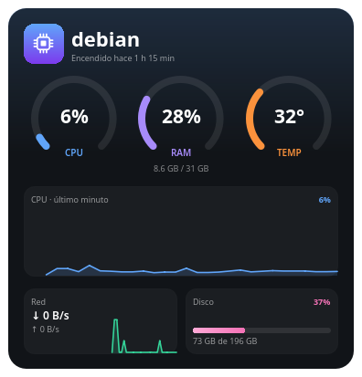
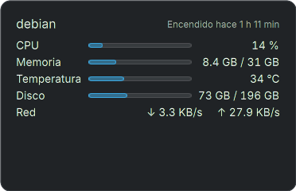

# Monitor del sistema — widget para KDE Plasma 6

Plasmoide que muestra CPU, memoria, temperatura, red y disco en una tarjeta oscura moderna, pensado para gastar lo mínimo.

## Capturas

| Estilo moderno | Estilo Plasma |
|---|---|
|  |  |

## Qué muestra

- Tres medidores: **CPU**, **RAM** (con usada / total) y **temperatura** del procesador. Se ponen rojos al pasar de 90% (o 85 °C).
- Gráfica de la CPU del último minuto.
- Velocidad de bajada y subida de red, con su gráfica.
- Espacio usado en disco.
- Nombre del equipo y cuánto tiempo lleva encendido.
- **En el panel:** dos mini medidores (CPU y RAM) con el porcentaje; clic para ver la tarjeta completa.

## Estilos

Clic derecho en el widget → **Configurar** → **Apariencia**:

- **Plasma**: componentes y colores de tu tema (respeta claro/oscuro, el color de acento y el fondo normal de los widgets). Se ve como los widgets que trae KDE.
- **Moderno** (por defecto): tarjeta oscura con efectos.

Solo se carga el diseño elegido: cada estilo vive en su propio archivo (`FullRepresentationPlasma.qml`, `FullRepresentationModern.qml`, …) y `StyleLoader.qml` abre únicamente el que toca.

### Agregar un estilo nuevo

1. Crea `contents/ui/FullRepresentation<Nombre>.qml` y `contents/ui/CompactRepresentation<Nombre>.qml`. Toman los datos y acciones de `root` (definidos en `main.qml`).
2. Agrega la opción en `contents/ui/configAppearance.qml` y su nombre en `StyleLoader.qml`.

## Por qué gasta poco

- Lee los datos de `ksystemstats`, el servicio que ya usan los monitores de Plasma: no lanza procesos ni lee archivos por su cuenta.
- Actualiza cada 2 s cuando se ve, y cada 4 s en el panel cerrado. Temperatura, red, disco e historial se apagan cuando no se ven.
- Dibuja con formas vectoriales (`QtQuick.Shapes`): sin capas, blur ni animaciones continuas.
- Medido en reposo: ~0.5% de un núcleo.

## Instalación

```bash
cd system-monitor
kpackagetool6 --type Plasma/Applet --install .
```

Después: clic derecho en el escritorio o en el panel → **Añadir o gestionar widgets** → busca **Monitor del sistema**.

### Actualizar

```bash
kpackagetool6 --type Plasma/Applet --upgrade .
systemctl --user restart plasma-plasmashell
```

### Desinstalar

```bash
kpackagetool6 --type Plasma/Applet --remove local.systemmonitor
```
